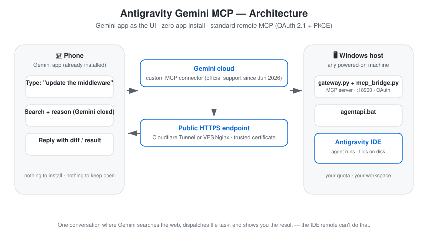

# Antigravity Gemini MCP

**Drive your Antigravity IDE from the Gemini app you already have on your phone. No app to install, no browser tab to keep open.**

[](LICENSE)
[](#)
[](#authentication)
[](#requirements)

---

## The idea

Every mobile remote for a coding agent builds its own UI. That is a lot of work, and you end up with a second place to type.

This project does the opposite: it **exposes your local Antigravity as a standard remote MCP server**, and lets **Gemini be the UI**. You open Gemini — the app already on your phone — and say:

> *"Search what changed in Next.js 16 middleware, then have Antigravity apply it to my project and show me the diff."*

Gemini's own search, reasoning and the Antigravity session all run **in one conversation**. That is something a browser-based IDE remote cannot do, because it only shows you the IDE.

Nothing to install on the phone. Nothing to host for the client. Just one HTTPS URL.

---

## What it looks like in practice



```
  Phone: Gemini app  ──►  Gemini cloud  ──►  your HTTPS endpoint
                                              │ (OAuth 2.1 + PKCE)
                                              ▼
                                     gateway.py + mcp_bridge.py
                                              │  :18900
                                              ▼
                                  agentapi.bat → Antigravity IDE
                                              │
                                        your files on disk
```

- 9 MCP tools: `list_projects`, `list_conversations`, `check_server_health`, `create_and_send_task`, `send_message`, `get_task_result`, `stop_task`, `list_files`, `read_file_snippet`
- Sync mode for tasks under 50 s (`wait_seconds=45`), async mode for long jobs (`wait_seconds=0` → returns `conversation_id`, then poll `get_task_result` with `offset` / `max_chars`)
- Multi-window routing by `project_path`, plus newline folding so `cmd /c agentapi.bat` does not truncate multi-line prompts

---

## Compared with Google's Remote Control

| | Google Remote Control | **This (MCP bridge)** |
|---|---|---|
| Where you type | Antigravity's own web UI | **Gemini — search, reasoning, tools, same thread** |
| Install on phone | add to home screen | **nothing** |
| Can combine web research + code change in one turn | — | ✅ |
| Can read files off the host | — | ✅ `list_files` / `read_file_snippet` |
| Access surface | Google's own client | Google's **officially supported** custom MCP connector |
| Setup | zero | self-hosted gateway + HTTPS endpoint |

The two are complementary. Many people will run both: MCP bridge for "think + dispatch", official Remote Control for "review the diff in the real IDE UI".

---

## Requirements

| Side | Needs |
|---|---|
| Windows host | Windows 10/11, Python 3.9+, Antigravity IDE running |
| Phone | The Gemini app (or gemini.google.com) |
| Network | **Public HTTPS domain with a trusted CA certificate** — Gemini's backend will not reach a self-signed cert or a local address |
| Optional | A domain on Cloudflare (recommended for a stable tunnel URL) |

---

## Authentication

No shared secret is typed into Gemini. The bridge speaks real **OAuth 2.1**:

- `/.well-known/oauth-protected-resource`
- `/.well-known/oauth-authorization-server`
- PKCE + **RFC 7591 dynamic client registration**

Token lifetimes: access **30 days**, refresh **180 days**. The authorization page simply asks for the `auth_token` you put in `config.json` — that string is the only credential, so make it long.

---

## Quick start

### 1. Host

```bash
cd server
pip install -r requirements.txt
copy config.example.json config.json
```

Edit `server/config.json`:

```json
{
  "host": "127.0.0.1",
  "port": 18900,
  "auth_token": "use-a-long-random-string",
  "workspace_roots": ["D:\\YourWorkspace"],
  "default_model": "MODEL_PLACEHOLDER_M526"
}
```

Start Antigravity IDE, then:

```bash
python gateway.py
```

Optional silent keepalive: `watch_gateway.py`, `watch_cloudflared.py`, `launch_hidden.vbs`, or a scheduled task.

### 2. Public HTTPS endpoint

```bash
cloudflared tunnel --url http://127.0.0.1:18900          # quick test (random URL)
cloudflared tunnel run agy-remote                        # named tunnel + your domain
```

A named tunnel with your own domain is strongly preferred — the MCP connection stores the URL, and a random `trycloudflare.com` host changes on every restart.

### 3. Connect Gemini

1. Open **gemini.google.com** → Settings → **Connected Apps** → **Add a custom app**
2. Paste `https://your-domain.com/mcp`
3. Approve the OAuth page (enter your `auth_token`)
4. Once added there, the connector also appears in the **Gemini mobile app**

Then just talk to it. Ask for a task, or ask it to check `list_conversations` first.

---

## FAQ

**Does this need a cloud PC?**
No. Any Windows machine that stays powered on — a desktop, a mini PC, a laptop. The only hard requirement is a public HTTPS endpoint.

**Why HTTPS with a real certificate?**
Gemini's servers call your endpoint from the public internet. Self-signed certificates and plain HTTP are rejected by design. Cloudflare Tunnel gives you a valid cert for free.

**Is my Antigravity account involved?**
The agent runs locally inside Antigravity with your normal quota. This bridge does not move your Antigravity credentials anywhere; Gemini authenticates to *your* bridge via OAuth. Access to Antigravity itself is through Google's supported custom-MCP surface.

**Can a remote task brick the connection?**
Yes — if you ask a Gemini-dispatched session to edit or restart `gateway.py` / `mcp_bridge.py`, it kills its own link. Keep those two files out of remote scope.

**Only Gemini?**
The server is a standard Streamable HTTP MCP with OAuth discovery, so any MCP client that supports remote servers can connect — Claude, Cursor, and others. Gemini is simply the one that needs no extra app on your phone.

---

## Related

- [**antigravity-remote**](https://github.com/zz327455573/antigravity-remote) — native Android client with full-disk file transfer and resumable downloads.
- [antigravity-desktop-zh-cn](https://github.com/zz327455573/antigravity-desktop-zh-cn) — Simplified Chinese localization pack for the desktop app.

---

## 中文说明

**这个项目解决的不是"再造一个遥控器"，而是"不要再造 UI"。**

市面上 40 多个 Antigravity 手机遥控项目全都在自己写界面；这个项目反过来——把本地 Antigravity 封装成**标准远程 MCP 服务器**，让**你手机里现成的 Gemini 当界面**。于是"查资料 + 派任务 + 拉结果"能在同一个对话里完成，这是浏览器式遥控做不到的。

### 三个关键点

1. **手机端零安装**：不装 App、不加主屏幕，用你已有的 Gemini
2. **走官方插槽**：接入的是 Google 2026-06 开放的自定义远程 MCP 连接器，不是逆向
3. **不需要云电脑**：任何一台常开的 Windows 都行，家用台式机即可

### 三步接入

1. **电脑端**：`cd server` → `pip install -r requirements.txt` → 复制 `config.example.json` 为 `config.json`（改 `auth_token`、`workspace_roots`）→ 开着 Antigravity，跑 `python gateway.py`
2. **公网 HTTPS**：`cloudflared tunnel --url http://127.0.0.1:18900` 快速试用；长期建议建命名隧道 `agy-remote` 挂自己域名（MCP 会记住地址，随机域名重启就失效）
3. **接进 Gemini**：浏览器打开 `gemini.google.com` → 设置 → Connected Apps → 添加自定义 app → 填 `https://你的域名/mcp` → OAuth 页输入 `auth_token`。加完之后手机 Gemini 里也会出现

### 9 个工具

`list_projects` / `list_conversations` / `check_server_health` / `create_and_send_task` / `send_message` / `get_task_result` / `stop_task` / `list_files` / `read_file_snippet`

---

## 🔒 Security

- 切勿提交 `server/config.json`、`server/oauth_store.json`、真实域名或令牌。  
  Never commit `server/config.json`, `server/oauth_store.json`, private domains, or tokens.
- **远程自改保护**：不要让 Gemini 派发的远程会话修改或重启 `gateway.py` / `mcp_bridge.py`，否则会切断它自己的连接。  
  **Self-modification guard**: a remote session that edits or restarts the bridge kills its own link.

## License

MIT — see [LICENSE](LICENSE).
