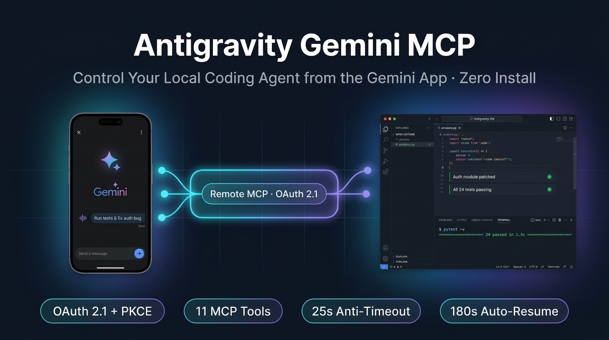
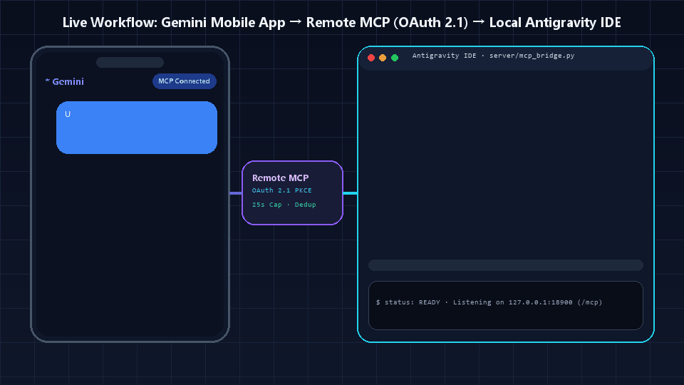
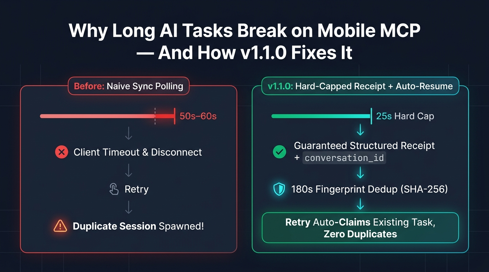
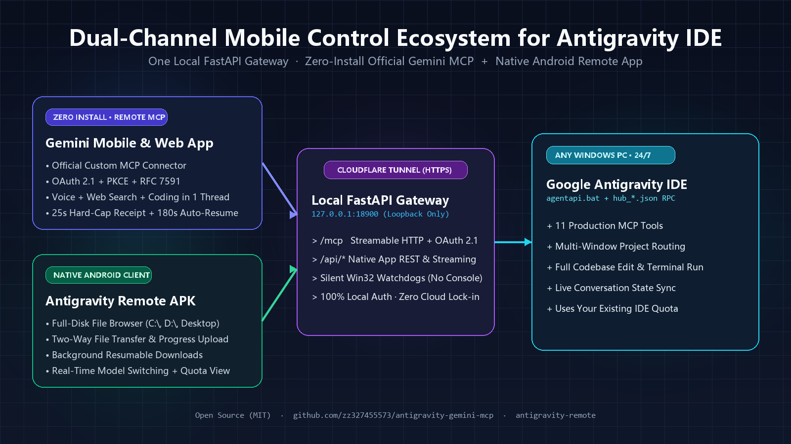

# Antigravity Gemini MCP

**Drive your local Google Antigravity IDE from the Gemini app already on your phone — zero app install, zero timeout disconnects, automatic retry recovery.**

[](#whats-new-in-v110--built-for-real-mobile-networks)
[](LICENSE)
[](#11-mcp-tools)
[](#authentication)
[](#requirements)

> **[中文文档 (README.zh-CN.md)](README.zh-CN.md)** · Companion native Android client: **[antigravity-remote](https://github.com/zz327455573/antigravity-remote)**



---

## The Idea

Every mobile remote for a coding agent builds its own chat UI. That means maintaining another frontend, another login, and losing the context of your main AI assistant.

This project flips the pattern: it **exposes your local Google Antigravity IDE as a standard remote MCP server** and lets **the Gemini app be the UI**. Open Gemini on your phone or desktop and say:

> *"Search what changed in Next.js 16 middleware, then have Antigravity apply it to my project, run the tests, and show me the diff."*

Gemini's web search, reasoning, voice input, and your local Antigravity IDE all run **in a single conversation**.

- **Zero install on your phone** — works inside the official Gemini app via Google's custom MCP connector.
- **No cloud PC required** — runs on any Windows machine you leave powered on.
- **Battle-tested for mobile networks (v1.1.0)** — 25-second hard-capped receipts + 180-second fingerprint deduplication prevent client disconnects and duplicate sessions.

---

## Live Workflow Demo



*Speak or type on Gemini mobile → OAuth 2.1 Remote MCP → local Antigravity IDE edits files, runs tests, and streams the result back into the same Gemini thread.*

---

## What's New in v1.1.0 — Built for Real Mobile Networks

Mobile MCP clients and cloud proxies silently drop connections if a tool call hangs for 50–60 seconds — and tapping **Retry** in naive implementations spawns duplicate coding sessions. **v1.1.0 solves both permanently:**



1. **25s Hard-Capped Receipts (`MAX_TOTAL_WAIT_SEC = 25`)**
   - Total request time (task dispatch + status polling) is strictly capped at **25 seconds**.
   - If the task finishes within 25s, you get the complete final output in one turn.
   - If it is still running at 25s (or dispatch alone took most of the budget), the gateway immediately returns a structured receipt (`ok: true`, `status: "running"`, `conversation_id`, `is_running`, `total_steps`, `recent_tools`) before any client or proxy timeout can fire.
2. **180s Fingerprint Dedup & Auto-Resume (`DEDUP_TTL_SEC = 180`)**
   - `create_and_send_task` and `send_message` maintain an in-memory SHA-256 fingerprint cache guarded by an `asyncio.Lock` and concurrent `pending` coalescing.
   - Retrying the same request within **180 seconds** never spawns a second session or duplicate message — it automatically claims the existing `conversation_id` (`"deduplicated": true`), resumes polling with the remaining budget, or returns the finished result immediately.

---

## Dual-Channel Ecosystem

One lightweight local FastAPI gateway (`127.0.0.1:18900`) powers **both** mobile workflows side by side:



- **[antigravity-gemini-mcp](https://github.com/zz327455573/antigravity-gemini-mcp)** (this repo) — zero-install remote MCP endpoint (`/mcp`) for Gemini Mobile/Web or any OAuth 2.1 MCP client.
- **[antigravity-remote](https://github.com/zz327455573/antigravity-remote)** — native Android client (`/api/*`) when you also want **full-disk file browsing (`C:\`, `D:\`)**, **two-way file transfers**, **resumable background downloads**, and **live model quota switching**.

---

## 11 MCP Tools

| Tool | Purpose | Key Parameters |
|---|---|---|
| `list_projects` | Discover Antigravity workspace directories | `keyword` (optional) |
| `create_project` | Create a new workspace folder under `workspace_roots` | `name`, `root_path` (optional) |
| `list_conversations` | List recent conversations with live status | `limit` (default 20, max 80) |
| `create_and_send_task` | Create a session & dispatch a task (180s dedup + 25s cap) | `prompt`, `project_path`, `title`, `model` (`default`/`fast`/`strong`), `wait_seconds` (`0–25`) |
| `send_message` | Send a follow-up prompt (180s dedup + 25s cap) | `conversation_id`, `content`, `model`, `wait_seconds` (`0–25`) |
| `get_task_result` | Poll live status & read chunked response | `conversation_id`, `offset`, `max_chars`, `wait_seconds` (`0–25`) |
| `stop_task` | Cancel a running conversation & confirm IDLE | `conversation_id` |
| `list_files` | List files and subdirectories on the host | `path` |
| `read_file_snippet` | Read up to 200 lines of a text file | `path`, `start_line`, `end_line` |
| `search_in_files` | Fast case-insensitive text search across a folder/file | `path`, `query`, `file_ext`, `max_results` |
| `check_server_health` | Inspect active `hub_*.json` instances, PIDs, ports & running tasks | `detail` |

- **Multi-window routing** by `project_path` (`hub_*.json` RPC + `agentapi.bat`), plus automatic newline folding so `cmd /c agentapi.bat` never truncates multi-line prompts.

---

## Compared with Google's Remote Control

| | Google Remote Control | **This (MCP bridge)** |
|---|---|---|
| Where you type | Antigravity's own web UI | **Gemini — search, voice, reasoning, tools, same thread** |
| Install on phone | Add to home screen | **Nothing** |
| Combine web research + code change in 1 turn | — | ✅ |
| Read & search files directly off host | — | ✅ `list_files` / `read_file_snippet` / `search_in_files` |
| Mobile timeout & retry protection | Built-in web socket | ✅ **25s hard-cap receipts + 180s dedup auto-resume** |
| Access surface | Google's own client | Google's **officially supported** custom MCP connector |
| Setup | Zero | Self-hosted gateway + HTTPS endpoint (~3 min) |

The two are complementary: use the **MCP bridge** for *"think + research + dispatch from Gemini"*, and **Remote Control** or **Antigravity Remote APK** for inspecting full diffs and transferring build artifacts.

---

## Requirements

| Side | Needs |
|---|---|
| Windows host | Windows 10/11, Python 3.9+, Google Antigravity IDE running |
| Phone | The Gemini app (or `gemini.google.com`) |
| Network | **Public HTTPS domain with a trusted CA certificate** — Gemini's backend rejects self-signed certs and plain HTTP |
| Optional | A domain on Cloudflare (free named tunnel for a permanent URL) |

---

## Authentication

No shared secret is pasted into Gemini. The bridge implements full **OAuth 2.1**:

- `/.well-known/oauth-protected-resource` (RFC 9728)
- `/.well-known/oauth-authorization-server` (RFC 8414)
- **PKCE (`S256` / `plain`)** + **RFC 7591 Dynamic Client Registration**

Token lifetimes: access **30 days**, refresh **180 days**. During authorization, the consent page verifies the `auth_token` from your local `server/config.json` — make it long and random.

---

## Quick Start (3 Steps)

### 1. Start the Local Gateway

```bash
cd server
pip install -r requirements.txt
copy config.example.json config.json
```

Edit `server/config.json`:

```json
{
  "host": "127.0.0.1",
  "port": 18900,
  "auth_token": "use-a-long-random-string",
  "workspace_roots": ["D:\\YourWorkspace"],
  "default_model": "MODEL_PLACEHOLDER_M526"
}
```

Open Antigravity IDE, then start the gateway:

```bash
python gateway.py
```

*(Optional silent Win32 background watchdogs with zero console windows: `watch_gateway.py`, `watch_cloudflared.py`, `launch_hidden.vbs`.)*

### 2. Expose a Public HTTPS Endpoint

```bash
cloudflared tunnel --url http://127.0.0.1:18900   # Quick test (random URL)
cloudflared tunnel run agy-remote                 # Named tunnel + your domain (recommended)
```

A named tunnel on your own domain is strongly recommended — Gemini stores the connector URL, whereas a temporary `trycloudflare.com` URL changes on restart.

### 3. Connect Gemini

1. Open **gemini.google.com** → Settings → **Connected Apps** → **Add a custom app**
2. Enter `https://your-domain.example.com/mcp`
3. Complete the OAuth authorization page using your `auth_token`
4. The connector immediately syncs to your **Gemini mobile app**

---

## FAQ

**Does this need a cloud PC?**  
No. Any Windows machine left powered on works — a home desktop, mini PC, or laptop.

**Why does Gemini require a real HTTPS certificate?**  
Gemini's cloud backend invokes your `/mcp` endpoint over the public internet and rejects plain HTTP or self-signed certificates. Cloudflare Tunnel provisions a valid TLS cert for free.

**Can a remote task break the MCP connection?**  
Yes — if you instruct a Gemini-dispatched session to edit or restart `gateway.py` or `mcp_bridge.py` directly, restarting the process drops its own live connection. Keep those two files out of remote self-modification scope unless explicitly restarting via an external watchdog.

**Only Gemini?**  
No — `/mcp` is standard Streamable HTTP MCP with OAuth 2.1 discovery, so Claude, Cursor, or any compatible remote MCP client can connect.

---

## Security

- Never commit `server/config.json`, `server/oauth_store.json`, real domains, public IPs, or tokens.
- Keep `gateway.py` bound to `127.0.0.1` and expose it only through an HTTPS tunnel.

## License

MIT — see [LICENSE](LICENSE).
