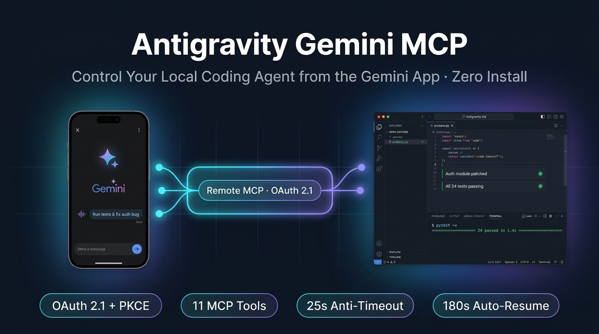
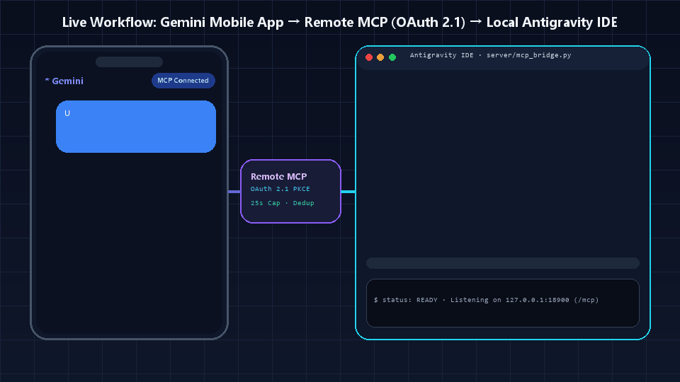
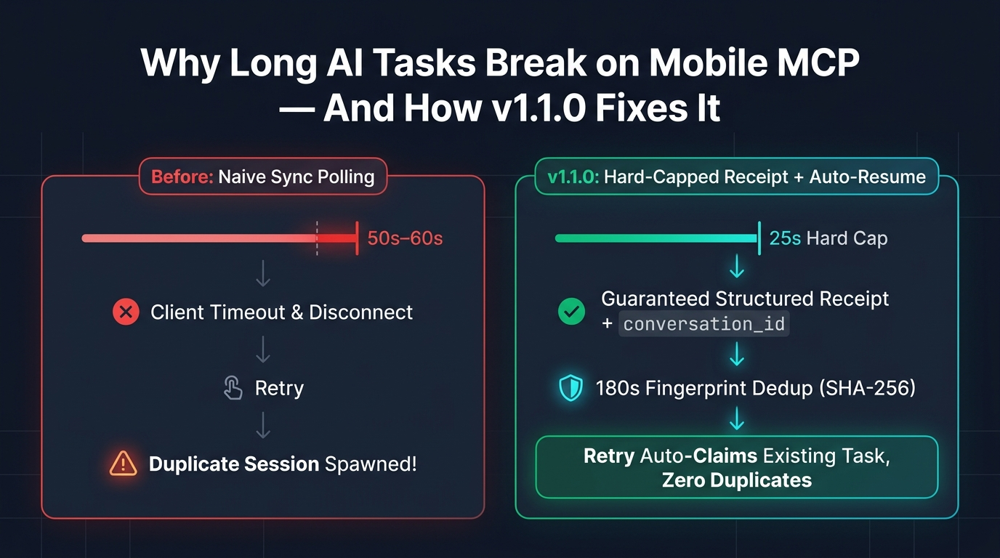
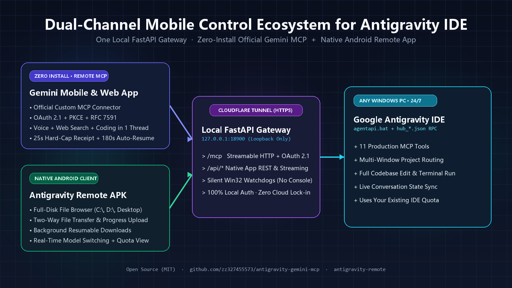

# Antigravity Gemini MCP

**不用在手机安装任何第三方 App，直接用手机里现成的 Gemini，通过官方远程 MCP 连接器指挥本地 Google Antigravity IDE 写代码、跑测试、查文件。**

[](#v110-核心升级专为移动弱网打造)
[](LICENSE)
[](#11-个-mcp-工具)
[](#鉴权机制)
[](#环境要求)

> **[English README](README.md)** · 同源原生安卓全盘遥控客户端：**[antigravity-remote](https://github.com/zz327455573/antigravity-remote)**



---

## 为什么做这个项目？

市面上的远程写代码工具几乎全都在“自己重画一套聊天界面”，结果手机上多装一个软件，还割裂了你原本的 AI 对话上下文。

**这个项目反其道而行之：不造新界面，而是把本地 Antigravity 封装成标准 Remote MCP 服务，直接让手机里现成的 Gemini 当遥控界面。** 对着手机说一句：

> *“先联网查一下 Next.js 16 中间件的最新改动，然后让 Antigravity 帮我改到项目里、跑一遍测试，最后把 diff 发给我看。”*

Gemini 自带的联网搜索、语音输入、逻辑推理和本地 Antigravity 编码执行，**在同一个对话里一气呵成**。

- **手机端零安装**：不装 APK、不加主屏幕网页，直接挂进官方 Gemini App。
- **不需要云电脑**：家里台式机、公司电脑、闲置小主机，只要开着 Windows 就能用。
- **v1.1.0 移动网络稳定性拉满**：25 秒硬封顶必交回执 + 180 秒指纹防重续接，彻底治好手机端 MCP 动不动超时断连、重试又双发任务的痛点。

---

## 实时工作流演示



*手机 Gemini 下达指令 → OAuth 2.1 安全隧道直达本地网关 → Antigravity 自动改代码并跑完单元测试 → 结果直接回到原对话。*

---

## v1.1.0 核心升级：专为移动弱网打造

手机端调远程 MCP 最常见两个致命坑：① 长任务在 50–60 秒附近直接被客户端/代理掐断；② 断连后用户点“重试”，本地又重复建了一个一模一样的会话。**v1.1.0 从协议层彻底解决：**



1. **单次请求总耗时严格封顶 25 秒（`MAX_TOTAL_WAIT_SEC = 25`）**
   - 从进入 `create_and_send_task`、`send_message`、`get_task_result` 第一行开始计时，“派发动作耗时 + 轮询等待耗时”之和严格不超过 **25 秒**。
   - 25 秒内干完直接返回完整最终结果；若仍在执行中（或派发本身耗尽预算），**到点立刻安全收口**，返回含 `ok: true`、`status: "running"`、`conversation_id`、`is_running`、`total_steps`、`recent_tools` 的结构化回执，绝不把连接拖死。
2. **180 秒内存级「任务指纹防重 + 断连续接」（`DEDUP_TTL_SEC = 180`）**
   - 对 `create_and_send_task` 与 `send_message` 生成 SHA-256 指纹，并配合 `asyncio.Lock` 与并发 `pending` 事件合并等待。
   - 180 秒内因断连或手抖重试相同请求：**严禁重复建会话或重发消息**，自动认领既有 `conversation_id`（标注 `"deduplicated": true`）并按剩余预算续接结果，已完成的直接吐出答案。

---

## 双通道生态：同一套网关，两种操控体验

本地一个轻量 FastAPI 网关（`127.0.0.1:18900`）同时驱动两条远程链路：



- **[antigravity-gemini-mcp](https://github.com/zz327455573/antigravity-gemini-mcp)**（本仓库）：面向 Gemini 手机端 / 网页端及其他支持 Remote MCP 的客户端（`/mcp`），**零安装、语音+联网+派活一体化**。
- **[antigravity-remote](https://github.com/zz327455573/antigravity-remote)**：原生 Android 客户端（`/api/*`），提供 **全盘浏览（`C:\`、`D:\`、桌面）**、**手机 ↔ 电脑双向传文件**、**锁屏不断连的后台断点续传下载** 以及 **实时模型与剩余额度切换**。

---

## 11 个 MCP 工具

| 工具名称 | 功能说明 | 核心参数 |
|---|---|---|
| `list_projects` | 列出本地 Antigravity 工作区项目目录 | `keyword`（可选关键词过滤） |
| `create_project` | 在 `workspace_roots` 下新建项目目录 | `name`, `root_path`（可选） |
| `list_conversations` | 列出最近会话及实时运行状态 | `limit`（默认 20，最大 80） |
| `create_and_send_task` | 新建会话并派发任务（含 180s 防重 + 25s 硬封顶） | `prompt`, `project_path`, `title`, `model` (`default`/`fast`/`strong`), `wait_seconds` (`0–25`) |
| `send_message` | 向已有会话发送追问指令（含 180s 防重 + 25s 硬封顶） | `conversation_id`, `content`, `model`, `wait_seconds` (`0–25`) |
| `get_task_result` | 查询实时状态并分页拉取最新输出 | `conversation_id`, `offset`, `max_chars`, `wait_seconds` (`0–25`) |
| `stop_task` | 中止正在运行的会话并确认进入 IDLE | `conversation_id` |
| `list_files` | 浏览电脑指定目录下的文件与子目录 | `path` |
| `read_file_snippet` | 读取文本文件片段（单次最多 200 行） | `path`, `start_line`, `end_line` |
| `search_in_files` | 在目录或文件中快速不区分大小写搜索文本 | `path`, `query`, `file_ext`, `max_results` |
| `check_server_health` | 检查在线 `hub_*.json` 实例、PID、端口与运行中任务 | `detail` |

- **多窗口自动路由**：按 `project_path` 自动匹配对应 `hub_*.json` 实例，派发前自动折叠换行并前置单行工作区约束，避免 Windows `cmd /c agentapi.bat` 截断多行指令。

---

## 环境要求

| 端 | 要求 |
|---|---|
| Windows 主机 | Windows 10/11，Python 3.9+，保持 Google Antigravity IDE 开启 |
| 手机端 | 官方 Gemini App（或网页端 `gemini.google.com`） |
| 网络 | **具备受信任 CA 证书的公网 HTTPS 域名**（Gemini 后端不接受纯 HTTP 或自签名证书） |
| 推荐方案 | Cloudflare Tunnel（免费自带受信任 HTTPS 证书，稳定不掉线） |

---

## 鉴权机制

无需把明文密码填进 Gemini，网关内置完整 **OAuth 2.1**：

- `/.well-known/oauth-protected-resource`（RFC 9728）
- `/.well-known/oauth-authorization-server`（RFC 8414）
- **PKCE（`S256` / `plain`）** + **RFC 7591 动态客户端注册**
- 令牌有效期：Access Token **30 天**，Refresh Token **180 天**。授权页面仅需输入你在 `server/config.json` 中设置的 `auth_token`。

---

## 三步快速部署

### 1. 启动本地网关

```bash
cd server
pip install -r requirements.txt
copy config.example.json config.json
```

编辑 `server/config.json`（务必设置高强度 `auth_token`）：

```json
{
  "host": "127.0.0.1",
  "port": 18900,
  "auth_token": "use-a-long-random-string",
  "workspace_roots": ["D:\\YourWorkspace"],
  "default_model": "MODEL_PLACEHOLDER_M526"
}
```

先打开 Antigravity IDE，再运行：

```bash
python gateway.py
```

*（仓库附带 `watch_gateway.py`、`watch_cloudflared.py`、`launch_hidden.vbs` 等 Win32 无黑框静默保活脚本，可配合 Windows 计划任务实现开机自启与自动看门狗。）*

### 2. 暴露公网 HTTPS 入口

```bash
cloudflared tunnel --url http://127.0.0.1:18900   # 快速体验（随机临时域名）
cloudflared tunnel run agy-remote                 # 命名隧道绑定自有域名（长期使用强烈推荐）
```

### 3. 接入 Gemini

1. 打开 **gemini.google.com** → 设置 → **Connected Apps（已关联的应用）** → **添加自定义应用**
2. 填入 `https://your-domain.example.com/mcp`
3. 在弹出的 OAuth 授权页输入 `auth_token` 确认授权
4. 添加成功后，**手机端 Gemini App 会自动同步出现该 MCP 工具**，直接语音或打字下达任务即可。

---

## 安全提醒

- 严禁提交 `server/config.json`、`server/oauth_store.json`、真实域名、公网 IP 或任何令牌。
- 网关默认仅监听 `127.0.0.1`，通过隧道暴露公网后 `auth_token` 是唯一门禁，请使用足够长的随机字符串。
- **远程自改保护**：不要让通过 Gemini MCP 派发进来的远程会话直接修改或重启正在服务它的 `gateway.py` / `mcp_bridge.py`，否则会立即切断当前通信链路。

## License

MIT — see [LICENSE](LICENSE).
